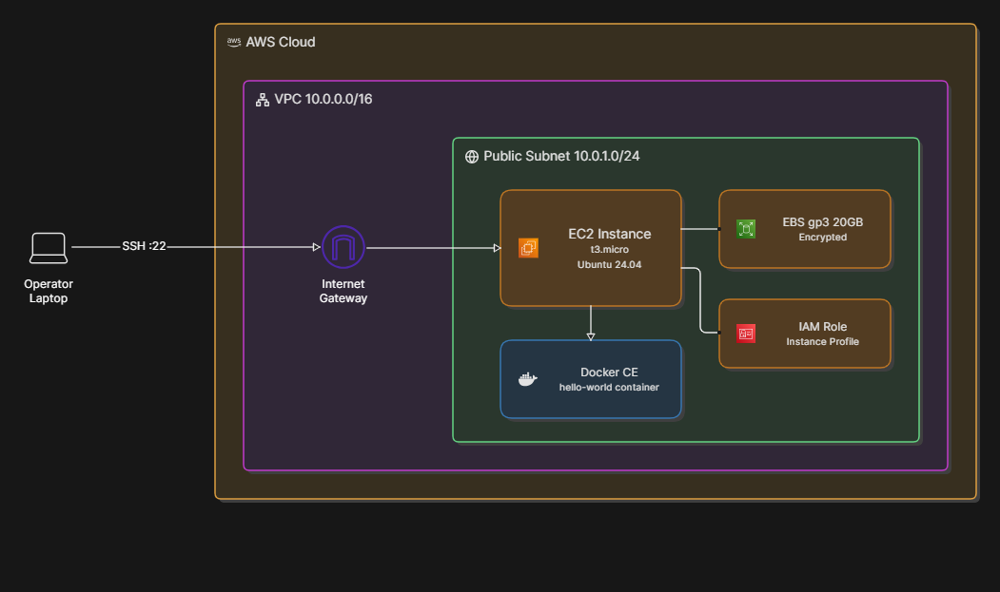
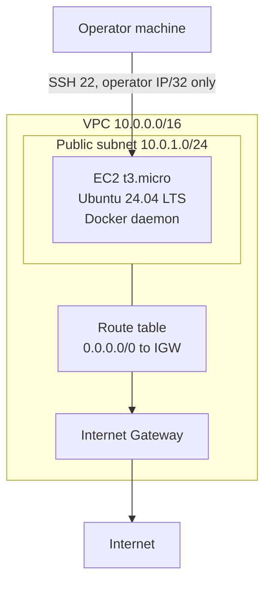
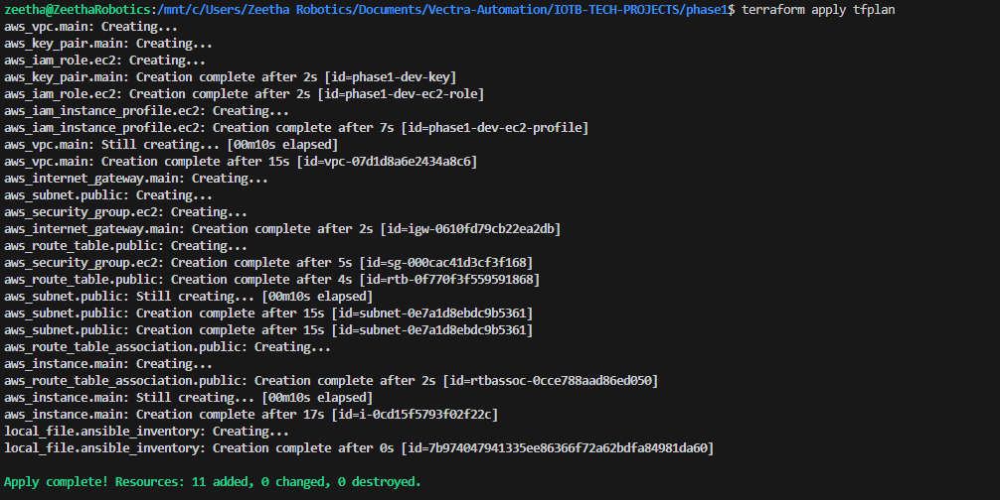
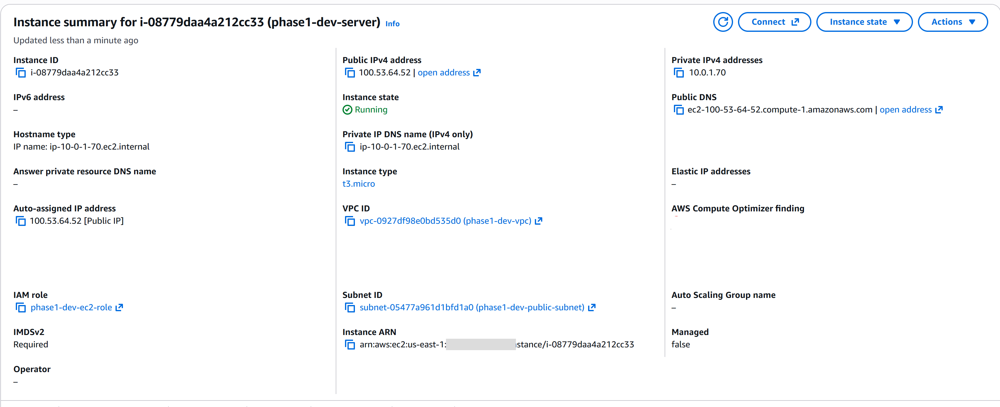
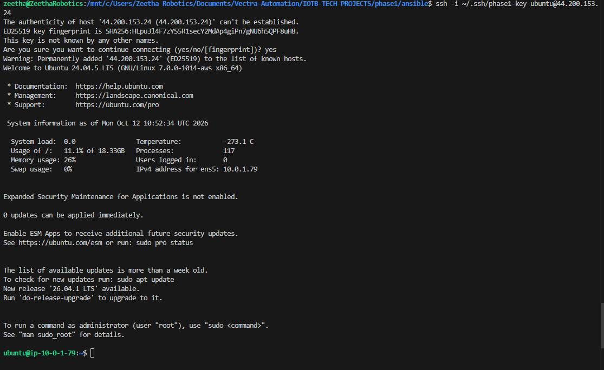
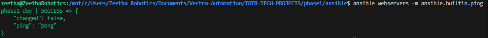
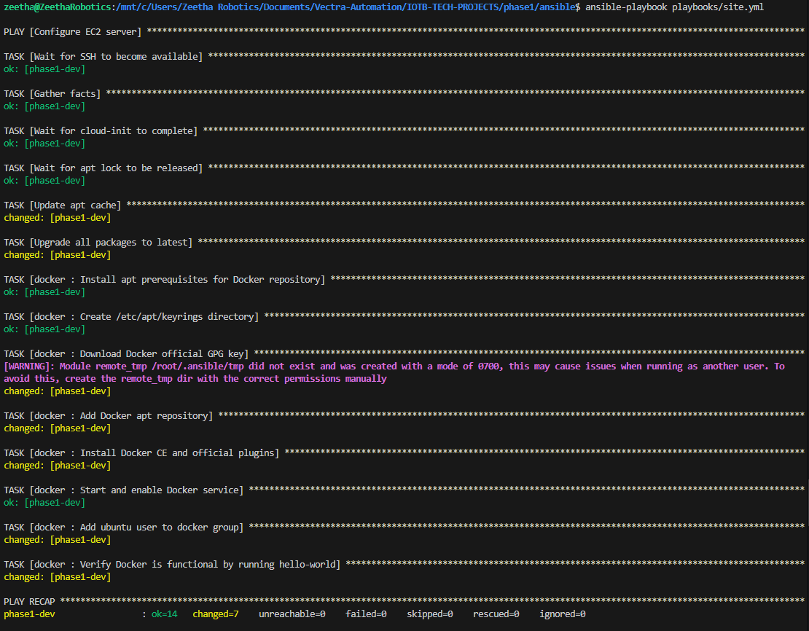
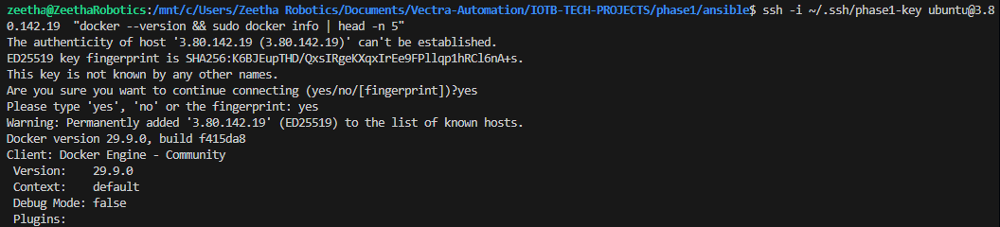
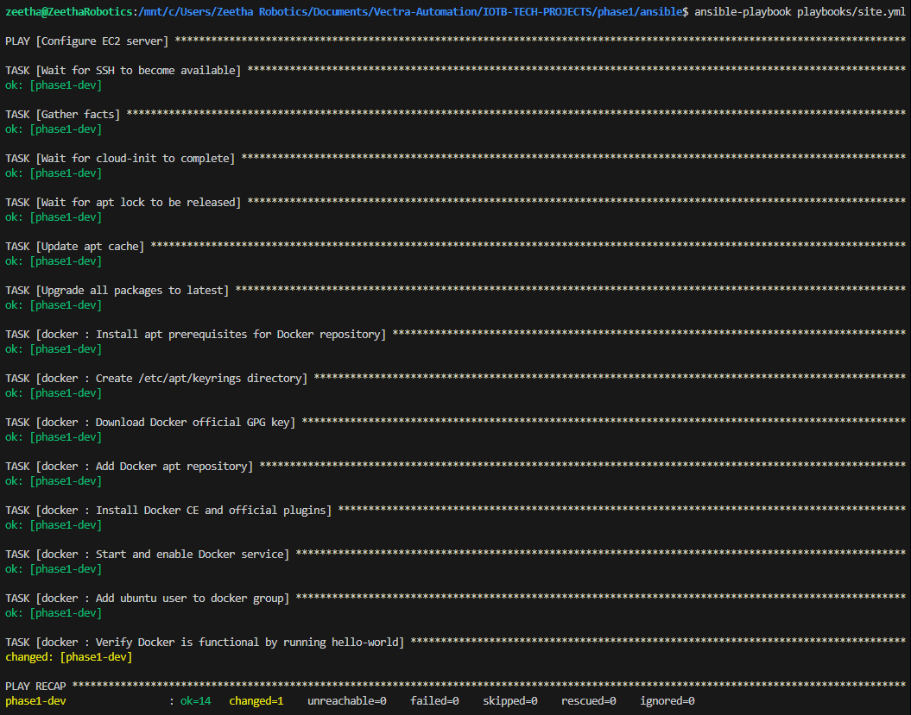
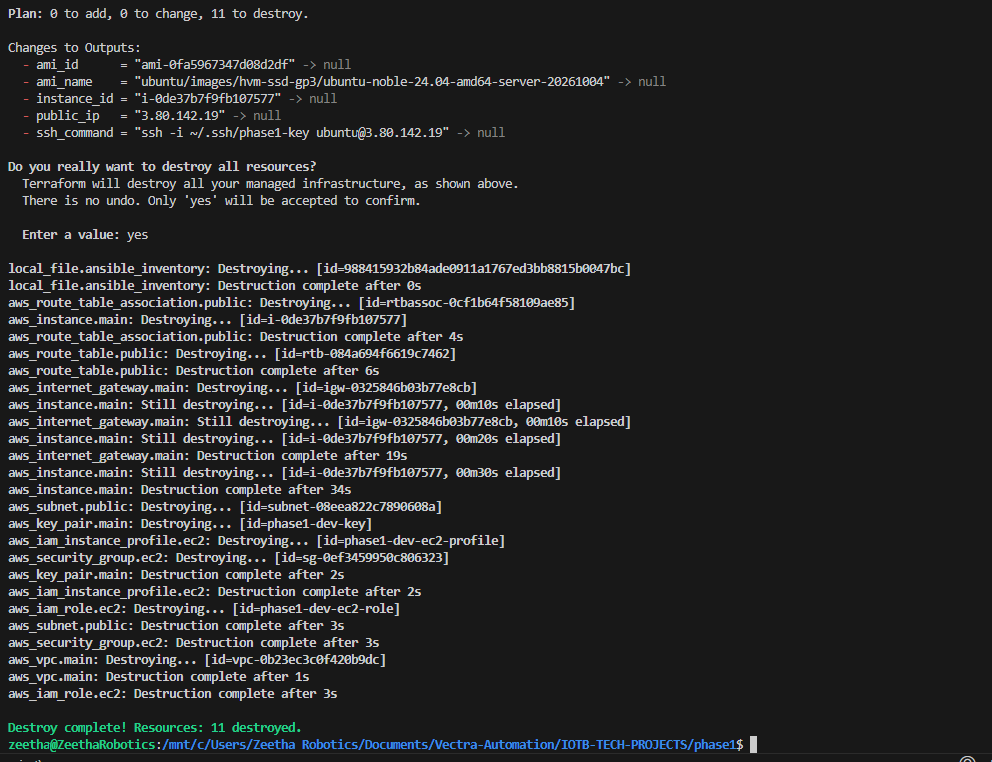

# AWS EC2 Provisioning and Docker Configuration with Terraform and Ansible

Infrastructure as Code project that provisions a hardened AWS EC2 instance (Ubuntu 24.04 LTS) with Terraform, then configures it with Ansible to run Docker CE from the official Docker apt repository. Infrastructure and configuration are deliberately separated so each can be changed and re-run independently.

This is Phase 1 of a three-phase project that builds toward a full CI/CD pipeline:

| Phase | Scope | Status |
|---|---|---|
| 1 (this repository) | Provision EC2 with Terraform, install and verify Docker with Ansible | Complete |
| 2 | Build a Docker image, push to Amazon ECR, pull and run on EC2, add S3 remote state backend | Planned |
| 3 | GitHub Actions pipeline automating build, push, and deploy | Planned |

## Highlights

- Reproducible, one-command-per-stage workflow: `terraform apply` for infrastructure, `ansible-playbook` for configuration.
- Security-first defaults: SSH restricted to a single /32, IMDSv2 enforced, encrypted EBS volume, least-privilege IAM role.
- Idempotent Ansible role, verified by a second run in which only the intentional verification task reports a change.
- Ansible inventory generated by Terraform (`templatefile()`), removing manual IP copying between tools.
- Design decisions and trade-offs documented explicitly (see [Design Decisions](#design-decisions-and-trade-offs)).

## Architecture





### Resource summary

| Component | Configuration |
|---|---|
| VPC | 10.0.0.0/16 |
| Subnet | Public, 10.0.1.0/24 |
| Security group | Ingress: TCP 22 from operator IP/32. Egress: all |
| Compute | EC2 t3.micro, Ubuntu 24.04 LTS (AMI resolved by data source) |
| Storage | 20 GiB gp3 EBS, encrypted |
| Instance metadata | IMDSv2 required (`http_tokens = "required"`) |
| IAM | Instance role with EC2 trust policy and no attached policies |

## Security Posture

| Control | Implementation | Rationale |
|---|---|---|
| Network exposure | SSH only, from a single operator IP | Minimises attack surface |
| Instance metadata | IMDSv2 required | Closes the IMDSv1 SSRF credential-theft path |
| Data at rest | Encrypted EBS volume | Protects data if the volume is detached or snapshotted |
| IAM | Role exists with zero permissions | Least privilege; Phase 2 attaches ECR read-only without replacing the instance |
| Secrets | Private key never leaves the local machine; Terraform reads only the `.pub` file | No credentials in state or source control |
| State file | Local state, gitignored | See [No remote state backend](#no-remote-state-backend) |

Known lab-only relaxation: `host_key_checking = False` in Ansible (see [below](#host_key_checking--false)).

## Prerequisites

| Requirement | Version | Check |
|---|---|---|
| Terraform | >= 1.7 | `terraform version` |
| AWS CLI | >= 2.x | `aws --version` |
| Ansible | >= 2.14 | `ansible --version` |
| Python | >= 3.9 | Control machine |
| AWS CLI profile | `phase1` | `aws configure --profile phase1` |

The AWS profile needs permission to create: VPC, subnets, internet gateway, route tables, security groups, key pairs, IAM roles and instance profiles, EC2 instances, and EBS volumes.

## Quick Start

```bash
# 1. Generate a key pair (private key stays local)
ssh-keygen -t ed25519 -f ~/.ssh/phase1-key -C "phase1-ec2"

# 2. Configure the AWS profile
aws configure --profile phase1

# 3. Set your IP in tfvars
cd phase1/
cp terraform.tfvars.example terraform.tfvars
#   edit terraform.tfvars: my_ip = "<YOUR_PUBLIC_IP>/32"
#   find your IP with: curl -s ifconfig.me

# 4. Provision infrastructure
terraform init
terraform plan -out=tfplan
terraform apply tfplan

# 5. Configure the instance
cd ansible/
ansible-playbook playbooks/site.yml
```

If you do not set a passphrase on the SSH key, Ansible runs non-interactively. For anything beyond a lab, use a passphrase with `ssh-agent`.

## Detailed Run Order

Run all commands from `phase1/` unless stated otherwise.

### 1. Static checks

```bash
terraform fmt -check -recursive
terraform init
terraform validate
```

Expected: `fmt` exits 0 with no output; `validate` prints `Success! The configuration is valid.`

### 2. Plan and apply

```bash
terraform plan -out=tfplan
terraform apply tfplan
```

The plan should show 11 resources to create, with an AMI name containing `noble-24.04`. Expected result: `Apply complete! Resources: 11 added, 0 changed, 0 destroyed.`

Outputs:

```
ami_id       = "ami-0xxxxxxxxxxxxxxxxx"
ami_name     = "ubuntu/images/hvm-ssd-gp3/ubuntu-noble-24.04-amd64-server-..."
instance_id  = "i-0xxxxxxxxxxxxxxxxx"
public_ip    = "x.x.x.x"
ssh_command  = "ssh -i ~/.ssh/phase1-key ubuntu@x.x.x.x"
```



The resulting instance as shown in the EC2 console: running `t3.micro` in the project VPC and public subnet, attached to the empty IAM role, with IMDSv2 set to Required and no Elastic IP.



### 3. Verify the generated inventory and SSH access

```bash
cat ansible/inventory/hosts.ini
ssh -i ~/.ssh/phase1-key ubuntu@<public_ip>
```



### 4. Ansible connectivity and syntax checks

```bash
cd ansible/
ansible webservers -m ansible.builtin.ping
ansible-playbook playbooks/site.yml --syntax-check
```

Expected ping result:

```
phase1-dev | SUCCESS => {
    "changed": false,
    "ping": "pong"
}
```



### 5. Dry run (optional)

```bash
ansible-playbook playbooks/site.yml --check
```

Check mode can fail on tasks that depend on earlier tasks having actually run (for example, adding the Docker apt repository before its prerequisites are installed). This validates task structure, not idempotency.

### 6. Apply configuration

```bash
ansible-playbook playbooks/site.yml
```

A successful first run ends with:

```
PLAY RECAP
phase1-dev : ok=N  changed=N  unreachable=0  failed=0  skipped=0
```



### 7. Verify Docker on the instance

```bash
ssh -i ~/.ssh/phase1-key ubuntu@<public_ip> "docker --version && docker info | head -5"
```



### 8. Idempotency check

```bash
ansible-playbook playbooks/site.yml
```

Expected: every task reports `ok` except `Verify Docker is functional by running hello-world`, which always reports `changed` (see [below](#docker-run-hello-world-is-not-idempotent)).



## Teardown

```bash
terraform destroy
```

Review the plan (11 resources) and confirm. This terminates the instance, removes the VPC and all network resources, and deregisters the key pair.



## Cost

Designed to run within AWS Free Tier limits for a single t3.micro and 20 GiB of EBS. Free Tier terms vary by account creation date, so check your account's current terms in the AWS Billing console.

| Resource | This project |
|---|---|
| EC2 t3.micro | 1 instance |
| EBS gp3 | 20 GiB |
| Elastic IP | Not used |
| Data transfer out | Minimal |

If left running outside the Free Tier, expect roughly $8 to $10 per month in us-east-1. Run `terraform destroy` when the environment is not in use.

## Design Decisions and Trade-offs

### Flat Terraform layout instead of modules

A single `main.tf` is used because, with one instance and one environment, modules add reading cost without reuse benefit. Modules should be extracted when a second caller exists. Phases 2 and 3 will refactor as networking and compute requirements diverge.

### No remote state backend

Local state avoids bootstrapping an S3 bucket and locking table before the first apply. The limitations are known: state is not shareable, is lost with the machine, and must never be committed. Phase 2 introduces an S3 remote backend.

### Terraform-generated Ansible inventory

`templatefile()` writes `hosts.ini` from Terraform outputs on every apply, so there is no manual IP copying. The file is gitignored. If the instance is stopped and started, its public IP changes and the inventory becomes stale; re-running `terraform apply` regenerates it, and an Elastic IP would remove the problem.

### No Terraform provisioners

`remote-exec` and `local-exec` run only at resource creation, do not appear in plans, and cannot be re-run without recreating the resource. Configuration is therefore handled solely by Ansible, so infrastructure and configuration can be iterated independently.

### IMDSv2 required

IMDSv1 allows any process able to issue an HTTP GET to read instance metadata, which is a well-known SSRF escalation path. Requiring session tokens closes it.

### Empty IAM role

The instance makes no AWS API calls in Phase 1, so it has no permissions. The role is created now so Phase 2 can attach `AmazonEC2ContainerRegistryReadOnly` without modifying the instance.

### docker run hello-world is not idempotent

`ansible.builtin.command` cannot report whether state changed, so the verification task always shows `changed`. The idempotent alternative, `community.docker.docker_container`, would require an extra Ansible collection and the Docker Python SDK on the control machine. For Phase 1 the simpler module was chosen, and the task is commented accordingly.

### host_key_checking = False

Disabling host key verification exposes the connection to man-in-the-middle attacks. It is accepted here only because lab instances are routinely destroyed and recreated. In production, pre-populate `known_hosts` with `ssh-keyscan` or use AWS Systems Manager Session Manager, and set `host_key_checking = True`.

## Limitations and Roadmap

Known limitations of Phase 1, and where each is addressed:

- Local Terraform state (Phase 2: S3 remote backend)
- Single environment, flat configuration (Phases 2 and 3: module refactor)
- Manual Ansible execution after apply (Phase 3: pipeline automation)
- SSH-based access with host key checking disabled (production: Session Manager)

## Repository Layout

```
phase1/
  main.tf
  terraform.tfvars.example
  ansible/
    inventory/hosts.ini        # generated by Terraform, gitignored
    playbooks/site.yml
    roles/docker/
docs/
  images/                      # screenshots referenced by this README
```

## Author

Abdulmuiz
GitHub: [Devzane](https://github.com/Devzane)