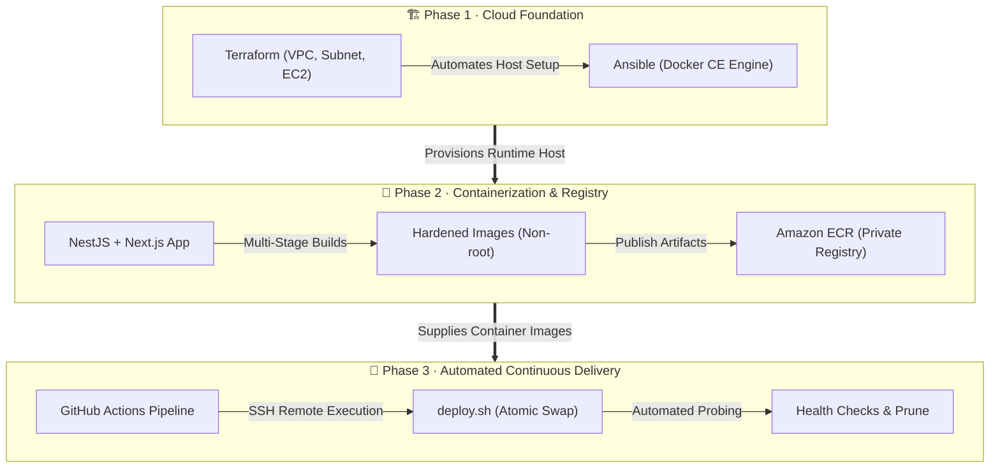
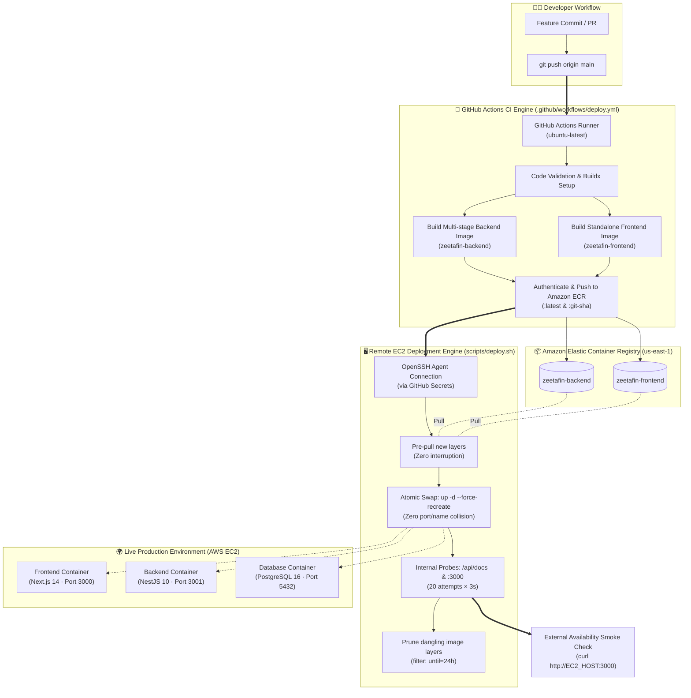

<div align="center">

# ⚡ ZeetaFin ERP — DevOps Engineering Suite
### Production-Grade AWS Infrastructure, Multi-Tier Containerization & Automated CI/CD Engine

[](https://aws.amazon.com/)
[](https://www.terraform.io/)
[](https://www.ansible.com/)
[](https://www.docker.com/)
[](https://github.com/features/actions)
[](https://nextjs.org/)
[](https://nestjs.com/)
[](https://www.postgresql.org/)

<p align="center">
  <b>A comprehensive, enterprise-grade multi-phase DevOps implementation featuring Infrastructure as Code (IaC), configuration automation, multi-stage container optimization, Amazon ECR distribution, and zero-collision continuous delivery on AWS.</b>
</p>

[Explore Phases](#-project-roadmap--implementation-phases) • [Architecture](#-end-to-end-system-architecture) • [Quickstart](#-quickstart--deployment-runbook) • [Security](#-production-hardening--security-posture) • [Repository Tree](#-repository-structure)

---

</div>

## 📌 Executive Overview

The **ZeetaFin DevOps Engineering Suite** showcases the real-world evolution of an enterprise full-stack ERP system from raw AWS cloud infrastructure to an automated, self-healing, zero-downtime container rollout engine.



---

## 🗺️ Project Roadmap & Implementation Phases

| Phase | Milestone | Tech Stack | Status | Documentation |
| :---: | :--- | :--- | :---: | :--- |
| **Phase 1** | **Cloud Infrastructure & Configuration Automation** | Terraform, Ansible, AWS EC2, Ubuntu 24.04, Docker CE |  | [📖 Phase 1 Operational Guide](./phase1/README.md) |
| **Phase 2** | **Application Containerization & ECR Distribution** | Docker, Docker Compose, NestJS, Next.js 14, PostgreSQL 16, Amazon ECR |  | [📖 Phase 2 Containerization Guide](./phase2/README.md) |
| **Phase 3** | **Automated CI/CD Pipeline & Remote Rollout Engine** | GitHub Actions, Amazon ECR, SSH Automation, Docker Compose, Health Probes |  | [📖 Phase 3 CI/CD Deployment Guide](./phase3/README.md) |

---

## 🏗️ End-to-End System Architecture



---

## 🔍 Phase Summaries & Deep Dives

### [Phase 1: Cloud Infrastructure & Configuration Management](./phase1/README.md)
* **Objective:** Automated, repeatable provisioning of an AWS EC2 instance running Ubuntu 24.04 LTS and programmatic installation of Docker CE.
* **Key Implementations:**
  * **Modular Terraform:** Provisions a custom VPC (`10.0.0.0/16`), public subnet (`10.0.1.0/24`), Internet Gateway, route table, and security group.
  * **Security-First Defaults:** Restricts SSH ingress to a single `/32` IP, enforces AWS IMDSv2, attaches an encrypted 20 GiB `gp3` root EBS volume, and provisions a least-privilege IAM instance profile.
  * **Ansible Idempotency:** Dynamic inventory generation (`templatefile()`) with modular Ansible roles installing official Docker CE, verified through idempotency tests.

### [Phase 2: Multi-Tier Containerization & ECR Distribution](./phase2/README.md)
* **Objective:** Containerize the full-stack ZeetaFin ERP application suite with production-grade security, minimal footprint, and publish to Amazon ECR.
* **Key Implementations:**
  * **NestJS Backend (`zeetafin-backend`):** 3-stage Dockerfile (`deps` $\rightarrow$ `builder` $\rightarrow$ `runner`) delivering a lightweight runtime image running as non-root user `node` (UID 1000).
  * **Next.js 14 Frontend (`zeetafin-frontend`):** Leverages Next.js standalone output bundling (`output: 'standalone'`), dropping image size from >1 GB down to **224 MB**, running as non-root user `nextjs` (UID 1001).
  * **Local Stack Testing:** Full-stack integration via `docker-compose.yml` orchestrating PostgreSQL 16, backend API, and frontend web client with internal network isolation.

### [Phase 3: Automated CI/CD & Zero-Collision Rollout Engine](./phase3/README.md)
* **Objective:** Autonomous deployment pipeline executing over GitHub Actions and SSH into AWS EC2 with health probes and zero downtime.
* **Key Implementations:**
  * **Automated CI/CD:** `.github/workflows/deploy.yml` triggers on push, builds both container images in parallel, tags them with immutable commit SHAs, and pushes them to Amazon ECR.
  * **Zero-Collision Container Swap:** `phase3/scripts/deploy.sh` pre-pulls new layers before touching running services, then atomically replaces containers using `docker compose up -d --remove-orphans --force-recreate` in milliseconds.
  * **Dual-Tier Health Probes:** Validates internal service readiness (`curl` retry loop against `/api/docs` and `:3000`), followed by an external public smoke check from GitHub's runner.
  * **Disk Hygiene:** Automatically executes `docker image prune -f --filter "until=24h"` to protect the EC2 host from disk exhaustion.

---

## 🌐 Network & Service Topology

| Tier | Service | Port | Base Image | Security Context | Health Check URL |
| :--- | :--- | :---: | :--- | :--- | :--- |
| **Frontend** | `zeetafin-frontend` | `3000` | `node:20-alpine` | Non-root (`nextjs:nodejs`, UID 1001) | `http://<HOST>:3000/` |
| **Backend** | `zeetafin-backend` | `3001` | `node:20-alpine` | Non-root (`node`, UID 1000) | `http://<HOST>:3001/api/docs` |
| **Database** | `zeetafin-db` | `5432` | `postgres:16-alpine` | Dedicated `postgres` user | `pg_isready -U postgres` |

---

## 🚀 Quickstart & Deployment Runbook

### 1. Local Full-Stack Development
To test the complete ZeetaFin stack locally without AWS dependencies:

```bash
# Clone the repository
git clone https://github.com/Devzane/IOTB-TECH-PROJECT.git
cd IOTB-TECH-PROJECT/phase2

# Launch the complete local multi-container stack
docker compose up -d --build

# Verify running containers
docker compose ps
```
Access the application:
* 🌐 **Frontend UI:** [http://localhost:3000](http://localhost:3000)
* 📑 **Backend API Docs (Swagger):** [http://localhost:3001/api/docs](http://localhost:3001/api/docs)

---

### 2. Infrastructure Provisioning (Phase 1)
```bash
cd phase1

# Initialize and apply Terraform infrastructure
terraform init
terraform plan
terraform apply -auto-approve

# Configure host with Ansible (Docker CE installation)
ansible-playbook -i ansible/inventory.ini ansible/playbook.yml
```

---

### 3. Automated Continuous Delivery (Phase 3)
Ensure the following GitHub Secrets are configured in your repository:
* `AWS_ACCESS_KEY_ID` & `AWS_SECRET_ACCESS_KEY`
* `AWS_REGION` (e.g., `us-east-1`)
* `EC2_HOST` (Public IPv4 of your Phase 1 EC2 instance)
* `EC2_USERNAME` (`ubuntu`)
* `EC2_SSH_KEY` (Private SSH key corresponding to your EC2 key pair)

Once configured, any push to `main` triggers `.github/workflows/deploy.yml` automatically!

---

## 📂 Repository Structure

```text
.
├── .github/
│   └── workflows/
│       └── deploy.yml            # Automated CI/CD pipeline (ECR build + SSH deployment)
├── phase1/                       # Infrastructure as Code & Configuration Management
│   ├── ansible/                  # Ansible playbooks & Docker CE modular roles
│   ├── docs/images/              # Architecture diagrams & operational proof screenshots
│   ├── main.tf                   # Terraform root module (VPC, Subnet, SG, EC2, IAM)
│   ├── outputs.tf                # Infrastructure output exports (public IP, IDs)
│   ├── variables.tf              # Configurable Terraform variables
│   └── README.md                 # Complete Phase 1 operational documentation
├── phase2/                       # Application Containerization & ECR Deployment
│   ├── backend/                  # NestJS TypeScript REST API + Multi-stage Dockerfile
│   ├── frontend/                 # Next.js 14 Standalone App + Production Dockerfile
│   ├── docker-compose.yml        # Local multi-service stack (Postgres + Backend + Frontend)
│   └── README.md                 # Phase 2 containerization & ECR operational guide
├── phase3/                       # Container Orchestration & CI/CD Deployment
│   ├── .env.example              # Production environment template
│   ├── docker-compose.prod.yml   # Production compose manifest with ECR image references
│   ├── labs/                     # Comprehensive Phase 3 interactive lab guides
│   ├── scripts/
│   │   ├── deploy.sh             # Idempotent zero-collision EC2 deployment engine
│   │   └── healthcheck.sh        # Endpoint verification and status prober
│   └── README.md                 # Phase 3 CI/CD architecture & rollout documentation
├── AGENTS.md                     # Engineering standards & atomic Git commit protocol
└── README.md                     # Project portfolio root documentation
```

---

## 🛡️ Production Hardening & Security Posture

* **Non-Root Execution:** All application containers explicitly reject root privileges (`USER node` UID 1000, `USER nextjs` UID 1001).
* **Least-Privilege Networking:** Security groups restrict SSH ingress strictly to authorized IP blocks; backend and database ports can be scoped strictly to private networks.
* **Ephemeral AWS Credentials:** ECR Docker authentication utilizes short-lived 12-hour session tokens via `aws ecr get-login-password`.
* **Atomic Zero-Collision Rollouts:** Pre-pulling image layers ensures that container recreation happens in milliseconds, completely preventing port/name collisions.
* **Storage Reliability:** Automated layer pruning removes abandoned intermediate layers older than 24 hours to prevent host disk exhaustion.

---

## 📜 Development & Git Guidelines

This project strictly adheres to **Atomic & Granular Commits** according to the [Conventional Commits](https://www.conventionalcommits.org/) specification:
* `feat:` New deployment capabilities, Dockerfiles, or CI/CD jobs.
* `fix:` Bug fixes in scripts, network rules, or configuration files.
* `docs:` Architectural and operational documentation updates.
* `refactor:` Code and compose optimizations without behavioral shifts.

---

<div align="center">
  <sub>Built with ❤️ for enterprise cloud engineering excellence. Designed for automated AWS scalability.</sub>
</div>
