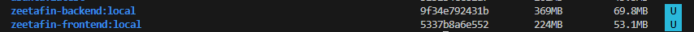
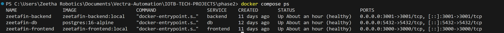
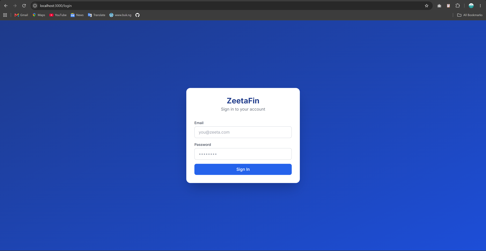
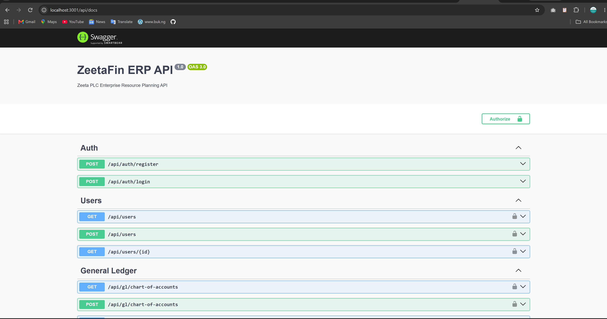
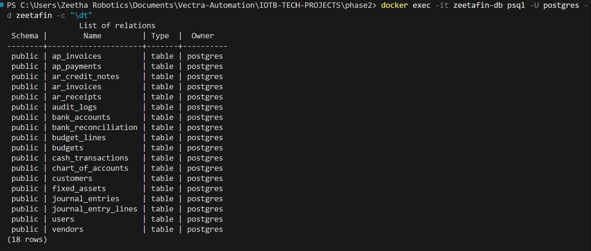
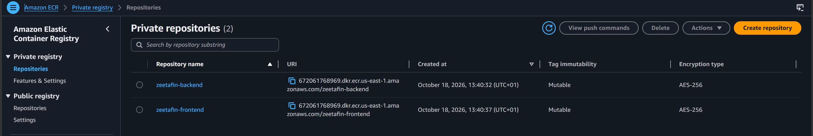

# Phase 2 — Application Containerization & Amazon ECR Deployment

## 1. Executive Summary & Overview
Phase 2 transitions the ZeetaFin Enterprise Resource Planning (ERP) platform from source code into hardened, production-ready, multi-stage Docker container images, verified locally via Docker Compose and prepared for deployment to Amazon Elastic Container Registry (Amazon ECR).

```text
[ Developer Machine ]
        │
        ├──► phase2/backend  ──(Multi-stage Dockerfile)──► zeetafin-backend:local  (369 MB)
        ├──► phase2/frontend ──(Standalone Dockerfile) ──► zeetafin-frontend:local (224 MB)
        └──► docker-compose.yml ──► [ Local Verification Stack ]
                                         │── zeetafin-db (PostgreSQL 16)
                                         │── zeetafin-backend (NestJS :3001)
                                         └── zeetafin-frontend (Next.js :3000)
                                         │
                                         ▼
                            [ Amazon ECR (us-east-1) ]
```

---

## 2. Architecture & Tech Stack Analysis

| Layer | Service | Framework / Engine | Port | Base Image | Security Context |
| :--- | :--- | :--- | :--- | :--- | :--- |
| **Frontend** | `zeetafin-frontend` | Next.js 14, React 18, Tailwind CSS | `3000` | `node:20-alpine` | Non-root (`nextjs:nodejs`, UID 1001) |
| **Backend** | `zeetafin-backend` | NestJS 10, TypeORM, Swagger, Passport JWT | `3001` | `node:20-alpine` | Non-root (`node`, UID 1000) |
| **Database** | `zeetafin-db` | PostgreSQL 16 | `5432` | `postgres:16-alpine` | Dedicated postgres user |

---

## 3. DevOps Containerization Strategy

### A. Backend (`backend/Dockerfile`)
* **Multi-stage Build Pipeline:**
  1. `deps`: Resolves full dependency tree via `npm ci`.
  2. `builder`: Compiles TypeScript source code to native JavaScript in `dist/`.
  3. `runner`: Ultra-lightweight runtime containing only production dependencies (`npm ci --omit=dev`) and compiled code.
* **Security:** Runs as non-root user `node`.
* **Healthcheck:** Automated `wget` probe against `http://localhost:3001/api/docs`.

### B. Frontend (`frontend/Dockerfile`)
* **Next.js Standalone Build:** Leverages `output: 'standalone'` in Next.js configuration to bundle only necessary node modules directly into `.next/standalone`.
* **Layer Caching:** Isolates dependency installation (`package.json` + `package-lock.json`) before copying application code.
* **Security:** Custom non-root system user and group (`nextjs:nodejs`).
* **Healthcheck:** Automated HTTP spider against `http://localhost:3000/`.

---

## 4. Repository Structure

```text
phase2/
├── backend/
│   ├── src/                    # NestJS controllers, services, entities, DTOs
│   ├── .dockerignore           # Excludes node_modules, dist, .env, git
│   ├── Dockerfile              # Production multi-stage Docker build
│   └── package.json
├── frontend/
│   ├── app/                    # Next.js 14 App Router pages
│   ├── components/             # Reusable UI components
│   ├── .dockerignore           # Excludes node_modules, .next, .env, git
│   ├── Dockerfile              # Standalone multi-stage Docker build
│   └── package.json
├── docker-compose.yml          # Local multi-service orchestration
└── README.md                   # Operational guide & verification evidence
```

---

## 5. Local Orchestration & Verification

### Running the Full Stack
```bash
docker compose up -d
```

### Default Test & Admin Credentials
Once the stack is running, log into the web application or authenticate via the API using the seeded administrator credentials:

| Field | Value | Description |
| :--- | :--- | :--- |
| **Email / Username** | `admin@zeeta.com` | Pre-configured Finance Admin |
| **Password** | `admin123` | Encrypted via bcrypt (cost factor 10) |
| **Role** | `finance_admin` | Unrestricted access across all 6 financial modules |

### Database Seeding
If running against a clean PostgreSQL container, seed the database tables and admin user:
```bash
# Seed via the backend container:
docker exec -it zeetafin-backend node -e "require('./dist/seed.js')"

# Or seed via npm on host:
cd backend && npm run setup
```

### Verification Endpoints & Health Checks
* **Frontend Web Application:** [http://localhost:3000](http://localhost:3000) (Next.js App Router, full financial UI)
* **Backend REST API:** [http://localhost:3001/api](http://localhost:3001/api) (NestJS API gateway)
* **Backend Swagger API Documentation:** [http://localhost:3001/api/docs](http://localhost:3001/api/docs) (Interactive OpenAPI Explorer)
* **PostgreSQL Database:** `localhost:5432` (`db: zeetafin`, `user: postgres`)

---

## 6. Amazon ECR Deployment Guide

### 1. Authenticate Docker CLI to Amazon ECR
```bash
aws ecr get-login-password --region us-east-1 --profile phase1 | docker login --username AWS --password-stdin 672061768969.dkr.ecr.us-east-1.amazonaws.com
```

### 2. Create ECR Repositories with Vulnerability Scanning
```bash
aws ecr create-repository \
  --repository-name zeetafin-backend \
  --region us-east-1 \
  --profile phase1 \
  --image-scanning-configuration scanOnPush=true \
  --image-tag-mutability MUTABLE

aws ecr create-repository \
  --repository-name zeetafin-frontend \
  --region us-east-1 \
  --profile phase1 \
  --image-scanning-configuration scanOnPush=true \
  --image-tag-mutability MUTABLE
```

### 3. Apply Lifecycle Policy (Retain Last 10 Images)
```bash
aws ecr put-lifecycle-policy \
  --repository-name zeetafin-backend \
  --region us-east-1 \
  --profile phase1 \
  --lifecycle-policy-text '{"rules":[{"rulePriority":1,"description":"Retain last 10 images","selection":{"tagStatus":"any","countType":"imageCountMoreThan","countNumber":10},"action":{"type":"expire"}}]}'

aws ecr put-lifecycle-policy \
  --repository-name zeetafin-frontend \
  --region us-east-1 \
  --profile phase1 \
  --lifecycle-policy-text '{"rules":[{"rulePriority":1,"description":"Retain last 10 images","selection":{"tagStatus":"any","countType":"imageCountMoreThan","countNumber":10},"action":{"type":"expire"}}]}'
```

### 4. Tag Docker Images for ECR
```bash
docker tag zeetafin-backend:local 672061768969.dkr.ecr.us-east-1.amazonaws.com/zeetafin-backend:latest
docker tag zeetafin-frontend:local 672061768969.dkr.ecr.us-east-1.amazonaws.com/zeetafin-frontend:latest
```

### 5. Push Images to Amazon ECR
```bash
docker push 672061768969.dkr.ecr.us-east-1.amazonaws.com/zeetafin-backend:latest
docker push 672061768969.dkr.ecr.us-east-1.amazonaws.com/zeetafin-frontend:latest
```

---

## 7. Phase 2 Verification Evidence & Deliverables

Below is the complete visual evidence proving successful multi-stage container builds, local multi-service orchestration, UI/API availability, database persistence, and Amazon ECR publication.

### Deliverable 1: Optimized Multi-Stage Docker Images (`docker images`)
Proof of multi-stage build optimization showing lightweight image footprints for `zeetafin-backend` (~369 MB) and `zeetafin-frontend` (~224 MB standalone):



---

### Deliverable 2: Local Multi-Container Stack (`docker compose ps`)
Proof that all 3 services (`zeetafin-db`, `zeetafin-backend`, and `zeetafin-frontend`) are running locally with healthy status:



---

### Deliverable 3: Local Web Application UI (`http://localhost:3000`)
Proof of the Next.js 14 frontend rendering cleanly in the browser on `localhost:3000`:



---

### Deliverable 4: Backend REST API Swagger Documentation (`http://localhost:3001/api/docs`)
Proof of the interactive OpenAPI Swagger explorer running on `localhost:3001`:



---

### Deliverable 5: PostgreSQL Database Schema & Table Verification
Proof that PostgreSQL initialized and backend TypeORM migrations seeded all necessary ERP tables:



---

### Deliverable 6: Amazon ECR Private Repositories in AWS Console
Proof that both `zeetafin-backend` and `zeetafin-frontend` private container repositories were successfully created in Amazon ECR with scan-on-push enabled:



